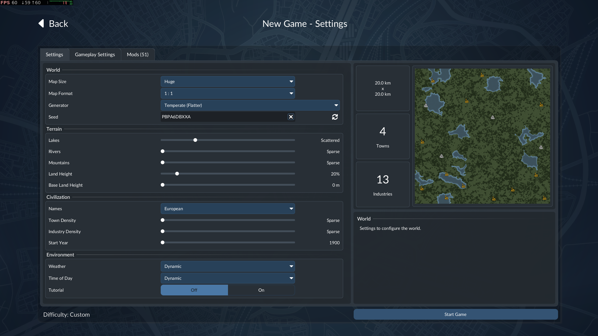

# Transport Fever 3 Town Frequency patch
Patch the base.json file to change the towns frequency values in a new game.

This patch was (obviously) written with claude (or any other llm for that matter). Research is my own. 

# Issues with tf3

The new game dialog is loaded in the base mod and the base gui before anything can be changed. There is no way to change the values via a mod at time of writing (2026-11-11) without some hacking of the base files (which you thus need to do anyway). You can delete the towns after creation as other mods do, but this sometimes messes with the level progression and leaves nasty spots on the map.

## Non standard zips
The base.zip is not a pkzip archive in the standard sense. As far as I can tell it uses fixed offsets and "UG" (very original urban games) as starting peamble. It doesn't need a matching CRC32 to the original (there is no signature match check) but in all wisdom the LLM assumes it does. This is bogus but I left it in since it does no harm.

# Install

Requirements: linux, python3 and perl, any normal linux system should have those pretty much by default. Ymmv on steamos variants. Windows/OSX/BSD users are on their own but it will likely work on BSD/OSX with perl and python3 installed.

```
cd [your tf3 game dir]
bash [location of patch]/patch_town_frequency.sh apply base/content/base.zip 0.05 0.1 0.2 0.3 0.4
```

Tested on debian 13 with nov 10. preview patch on 2026-11-11 (game version)

# Result
(experimental huge map, 0.05 town density)


# License

[CC-BY-NC 4.0](https://creativecommons.org/licenses/by-nc/4.0/deed.en) 

All rights of Transport Fever 3 and associated items are maintained and belong to their original owners.

Nothing can be claimed, done or assumed from this repository. No warranty exists in any form or matter. You do everything at your own risk.
